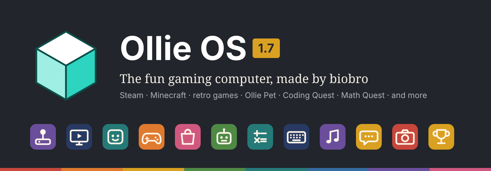
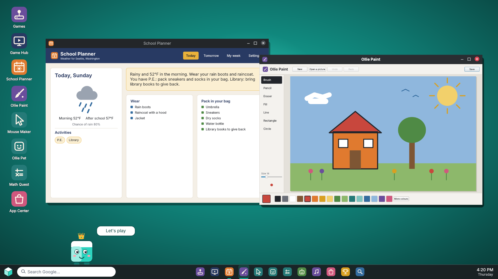
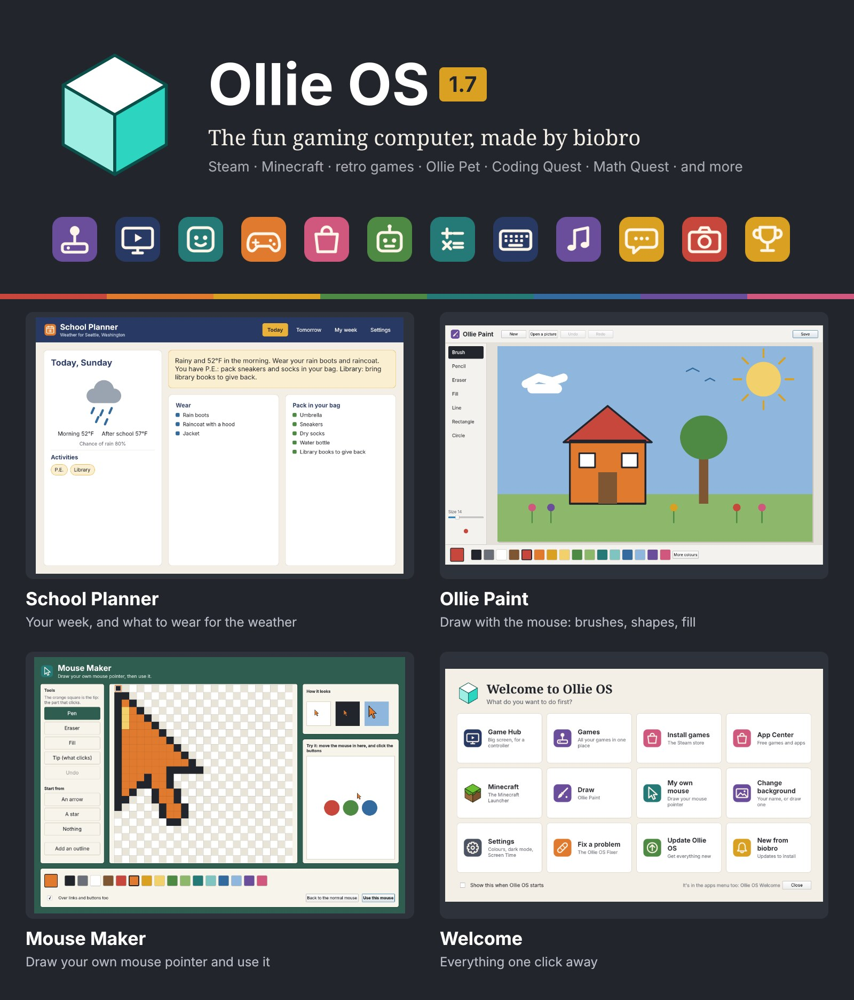

# Oliver DEMO AVAILABLE
Ollie OS was dreamed up, designed and tested by an 8-year-old, built with help from AI (Claude). Great for gaming: comes with Wine, Steam and more, plus a debugger and a driver installer. Easy to install KID FREINDLY WITH UPDATE VERSION 1.3

IF mac says will not let you open go to settings privacy gatekepper press lock and go to allow

## Ollie OS 1.6

**The fun gaming computer, made by biobro.** Ollie OS is built on Arch Linux
and starts straight into a colourful desktop with Steam (and its big-screen
Game Mode), Minecraft, retro games, and a whole set of its own apps for
playing, making and learning.

*The real Ollie OS desktop (from the automatic test).*

- **Play:** Game Hub (TV mode for controllers), Games (drop in ROMs and ISOs),
  App Center (free games, Epic & GOG, and Ollie's extra apps), Couch Co-op,
  Typing Game, Ollie Pet, Quick Menu, Play Time, Trophies
- **School:** School Planner (your week, and what to wear for the weather)
- **Make:** Ollie Paint, Mouse Maker (draw your own mouse pointer), Music Maker, Photo Booth, Comic Maker
- **Learn:** Coding Quest, Math Quest, Fun Fact of the Day, Ollie's Tour
- **In the App Center, to install if you want them:** Sticker Maker, Ollie
  Animator, Sound Board, Spelling Bee, World Explorer, Space Explorer
- **Windows too:** installing Ollie OS can put Windows 10 or 11 next to it
- **Keep it going:** works with Secure Boot on, one-click updates that save Ollie OS
  first (Undo an update goes back), the Update Checker, Recovery Mode,
  The Fixer, seasonal themes, Easy reading, 11 languages, and parent settings
  (Screen Time, Bedtime, Typing Scanner, Firefox password)

## How to get it

1. **Get the Installer** from the [Releases page](../../releases): Windows
   (`.exe`, inside the zip), Mac (`.dmg`, inside the zip), or Linux and Steam
   Deck (`.AppImage`).
2. **Run it.** It downloads the official Arch Linux ISO and turns it into
   Ollie OS on your computer. It takes 1 to 2 hours and about 20 GB of free
   space. No GitHub account or sign-in needed.
3. **Put it on a USB stick** (it asks at the end), then start the computer
   from the stick: Steam Deck and Steam Machine, hold **Volume Down**; Dell,
   tap **F12**; Mac, hold **Option**. Try it out, and if you like it, open
   **Install Ollie OS** on its desktop.

**Already have Ollie OS?** Download the **Ollie OS Latest Updater** and open it:
it brings everything new, then Update Ollie OS gets the rest. Later versions
can go on with **Recovery Mode**, keeping all your files.

## Questions

**Is it free?** Yes. Ollie OS is free, and so is Arch Linux, which it is built on.

**Will it delete Windows?** Not unless you choose that. Trying it from a USB
stick changes nothing on the computer. *Install Ollie OS* asks how: onto a
drive, which erases that drive (it warns you if Windows is on it), or into a
drive or folder *keeping everything on it*, where Ollie OS goes in one big
file. If Windows is on another drive, Ollie OS can put it on the start-up
menu so you pick each time.

**Can I have Windows too?** Yes. Installing Ollie OS onto a drive asks if you
want Windows too, then Windows 10 or 11 and how much of the drive it gets. It
downloads Windows from Microsoft (or uses a Windows .iso file you have), and
the next start runs Windows Setup: pick "Unallocated Space" there. Then the
start-up menu shows Ollie OS and Windows. Windows needs about 6 GB to download
and at least 64 GB of the drive, and asks for a product key (you can skip it).

**What computers does it work on?** 64-bit PCs and laptops with Intel or AMD
chips (new ones and older BIOS ones), Intel Macs, and the Steam Deck and
Steam Machine. It doesn't work on phones, tablets, Chromebooks with ARM
chips, or Macs with Apple chips (M1 and newer).

**What do I need?** A USB stick of 32 GB or more, and to install it, a drive
with at least 25 GB.

**Can I play my games?** Steam and its games (with Proton for Windows games),
Minecraft (the official launcher), retro games from ROMs and ISOs in the
Games app, and Windows programs with Oliver.

**Is it OK for kids?** It was made by one! Grown-ups can set Screen Time, the
Typing Scanner and a Firefox password in Ollie OS Settings, locked with a
parent PIN.

**How do I get updates?** Switch on the Update Checker (the first start
asks): when there's a new update you get a notification with an Install
button. Update Ollie OS keeps everything else up to date in one click.

🌐 Website: https://robertpjenkins-bot.github.io/Ollie-OS/
